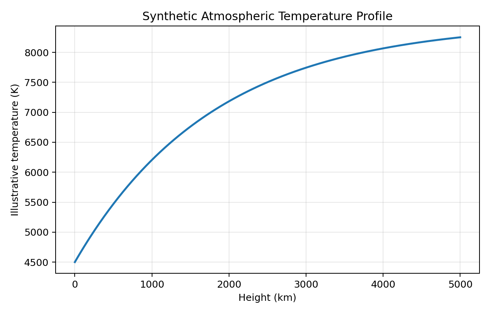
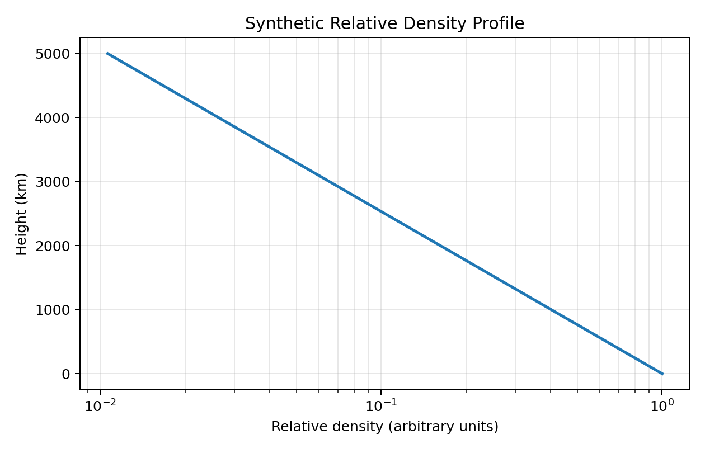
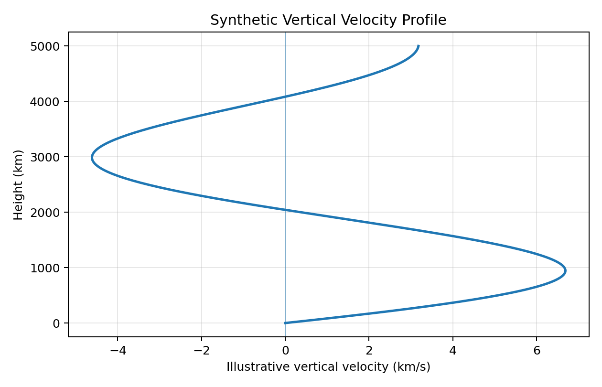

# scientific-python-visualization
Scientific plotting and data analysis using Python, NumPy, and Matplotlib
## Example Results

The following figures illustrate how Python can be used to visualize scientific profiles as a function of height. These are **synthetic demonstration data**, not actual solar observations or simulation results.

### Temperature Profile

### Density Profile

### Vertical Velocity Profile

## Skills Demonstrated

- Python programming
- NumPy for numerical arrays
- Matplotlib for scientific visualization
- Organizing reproducible scientific code

## Future Improvements

- Apply the plotting workflow to real radiative MHD simulation data, subject to data and supervisor permissions.
- Add physical units and improve plot labels.
- Explore diagnostics relevant to solar atmospheric structures.
